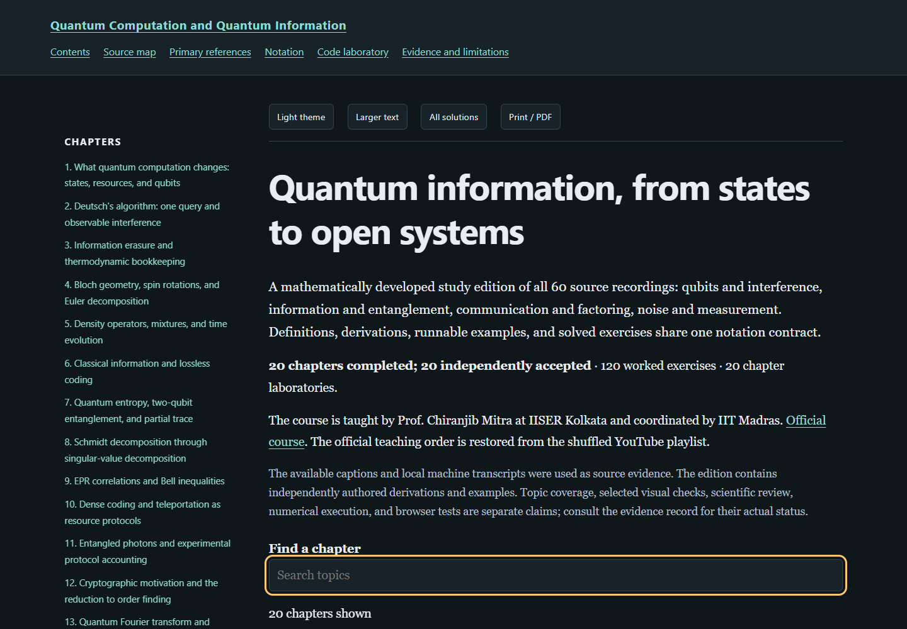

# Quantum Computation and Quantum Information — a textbook rewrite

**[Read the complete textbook](https://az9713.github.io/nptel-quantum-computation-information-notes/)**

An independent study edition of Prof. Chiranjib Mitra’s NPTEL course at IISER Kolkata, coordinated by IIT Madras. The [official course](https://nptel.ac.in/courses/115106925) and [lecture playlist](https://www.youtube.com/playlist?list=PLyqSpQzTE6M_-m8Ol5JZzvL6hb-4IzAcg) provide the teaching spine; the source map restores the official lecture order because the playlist is shuffled.

## What is included

- **20 chapters covering all 60 recordings**, with explicit assumptions, derivations, worked examples and primary references.
- **120 exercises with complete solutions** and **20 executable Python laboratories**, with the full source and saved output embedded in each chapter.
- An offline reader with bundled MathJax, dark and light themes, text sizing, chapter search, expandable solutions, code copying and print/PDF output.

[Source map](https://az9713.github.io/nptel-quantum-computation-information-notes/source-map.html) · [Primary references](https://az9713.github.io/nptel-quantum-computation-information-notes/references.html) · [Notation](https://az9713.github.io/nptel-quantum-computation-information-notes/notation.html) · [Code laboratory](https://az9713.github.io/nptel-quantum-computation-information-notes/code-lab.html) · [Evidence and limitations](https://az9713.github.io/nptel-quantum-computation-information-notes/evidence.html)

## Read and run locally

Clone this repository or download and extract its ZIP, then open `index.html`. The reading assets work offline; external recordings and papers require a network connection.

Install Python 3, then run the same commands in PowerShell, Git Bash or WSL:

~~~sh
python -m pip install -r requirements.txt
python code_lab.py --list
python code_lab.py --chapter 1
python tools/build_book.py
python tools/check_export.py
~~~

Run `python code_lab.py` to execute all laboratories. The source-free builder refreshes reader navigation around the existing accepted HTML bodies; it verifies their saved digests before writing. The checker validates local links, timestamp bounds, exact source/output embeds and all 20 executable laboratories without the private authoring tree.

## Review and verification

Every chapter has two independent agent editorial review rounds. Sidecars retain the final accepted canonical body digest, exported body digest and review report digests; the private reports are not published. This is editorial review, not formal mathematical proof verification.

- `editorial-review-summary.json`: chapter acceptance and review evidence.
- `package-validation.json`: structure, links, source spans, embeds and finite laboratory execution.
- `reader-validation.json`: all 20 chapters at desktop and mobile sizes; 3,471 expressions per edition rendered without mathematics errors.
- `source-free-validation.json`: the copied export checked without private inputs.
- `verification-environment.json`: the execution environment. Exact stdout was verified with Python 3.13.5, NumPy 2.2.6 and SciPy 1.16.0 on Windows AMD64; floating-point details may vary elsewhere.

[Publication checks](publication-validation.json) record served-file integrity and live desktop/mobile reader behavior for the named content commit, separately from scientific, code and local reader checks. See [WORKFLOW.md](WORKFLOW.md) for the production process.

## Source coverage and limits

Timestamped text came from 38 English auto-caption tracks and 22 local faster-whisper small.en transcripts. Assigned text was read sequentially; selected frames and primary references were checked where recorded. A complete audiovisual audit or reproduction of experimental apparatus is not claimed. Numerical assertions cover finite teaching cases.

Raw captions, recordings, source frames, downloaded papers, private authoring files and private review reports are excluded. This repository is an independent educational rewrite and is not an official NPTEL publication. MathJax is distributed under its [bundled license](assets/mathjax-LICENSE).
